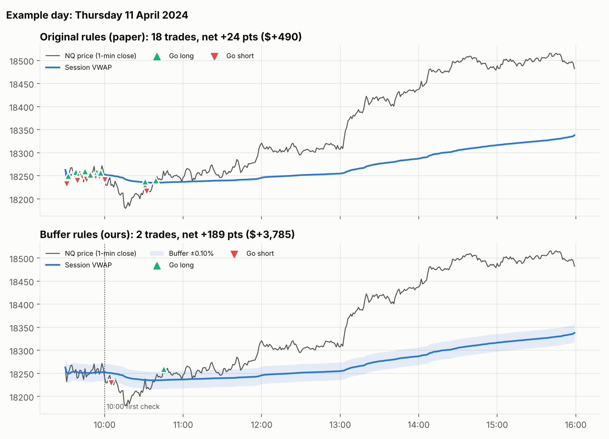
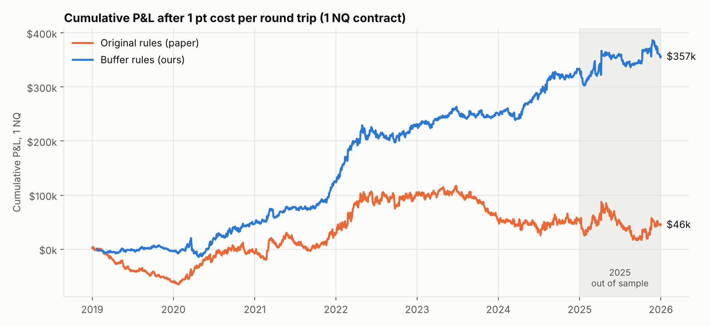
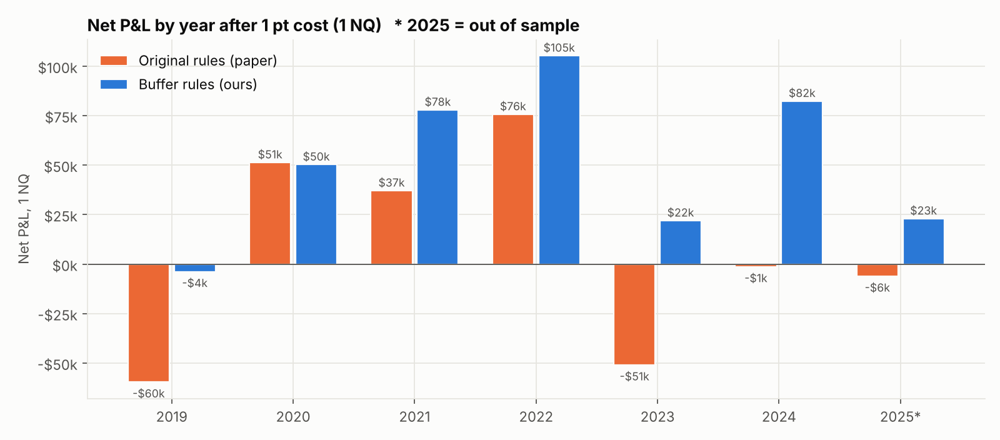
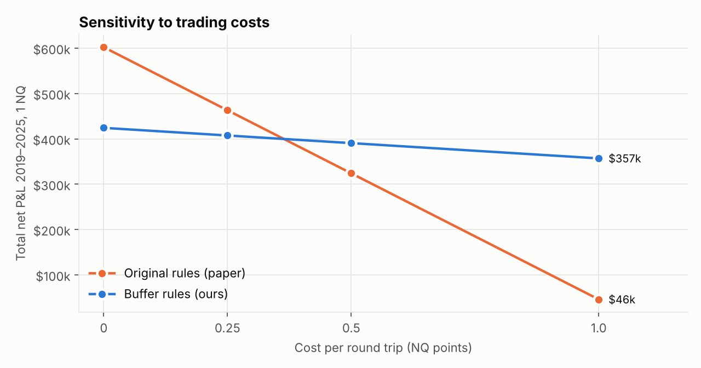
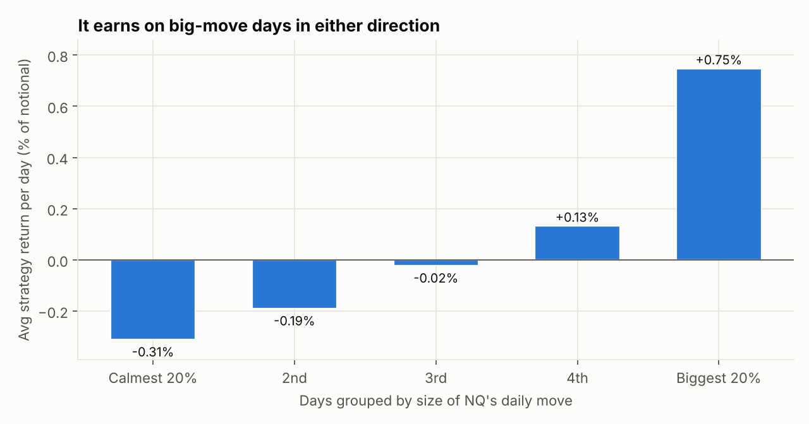

# VWAP Trend Strategy on Nasdaq-100 Futures (NQ)

This project adapts the intraday VWAP trend strategy from Zarattini & Aziz, *"Volume Weighted Average Price (VWAP): The Holy Grail for Day Trading Systems"* (2023), to NQ futures, and tests it with realistic trading costs.

The original rules flip position on every VWAP cross, about 16 times a day. At realistic futures costs, that turnover leaves almost nothing. Adding a **volatility-scaled buffer around VWAP** cuts turnover by about 85% and keeps the edge after costs.



## The strategy

| | Original rules (paper) | Buffer rules (ours) |
|---|---|---|
| Signal check | Every 1 min from 09:31 ET | Every 5 min from 10:00 ET |
| Go long | Close above VWAP | Close above VWAP × (1 + buffer) |
| Go short | Close below VWAP | Close below VWAP × (1 − buffer) |
| Otherwise | — | Hold the current position |
| Buffer | — | 0.15 × std of the previous 14 daily returns (≈ 0.1–0.3%) |
| FOMC decision days | Trade | Don't trade |
| End of day | Flat at the close | Flat at the close |

The VWAP is the session VWAP, anchored at 09:30 ET. Positions are always 1 contract, intraday only.

## Key results

NQ 1-minute data, 2019–2025, 1 contract ($20/pt), **after a 1-point cost per round trip** (commission + slippage). The rules were chosen using 2019–2024; **2025 was held out** as a forward test.

| | Original rules | **Buffer rules** |
|---|---|---|
| Net P&L 2019–2024 | $52,115 | **$333,980** |
| Sharpe 2019–2024 | 0.19 | **1.50** |
| 2025 (held out) | −$6,150 | **+$22,990** (Sharpe 0.35) |
| Max drawdown | −$100,740 | **−$35,255** |
| Trades per day | 16 | **2** |
| Gross profit per trade | 1.1 pts | **6.3 pts** |
| Win rate | 16% | 42% |





### Why the buffer works

Before costs, the original rules actually make more money. But each trade earns only about 1 point, roughly the same as a realistic cost. The buffer skips the small whipsaws around VWAP, so each trade is worth about 6 points, and the strategy barely notices costs.



### What it is: a long-volatility, market-neutral return stream

- **Beta to NQ is about 0:** −0.04, with daily correlation −0.07.
- **Alpha is about +20% a year, unlevered, in 2019–2024** (t-stat 3.2).
- **Both sides contribute:** longs made 54% of the profit and shorts 46%. Shorts carried 2022, when NQ fell 33% and the strategy made +$105k per contract.
- It **loses slowly on quiet days and earns on big-move days in either direction.** That's the classic trend-following profile.



## What didn't help

These were tested with walk-forward or train/validation splits and didn't improve results out of sample:
- Re-optimizing the parameters each year
- Day filters known before the open: gap, opening range, volatility regime, day of week
- ML models predicting winning trades (AUC ≈ 0.55, never beat a random filter)
- Volatility-forecast position sizing
- Stop-losses, daily loss limits, caps on trades per day, equity-curve filters
- Real-time chop filters (efficiency ratio, VWAP-cross counts)
- Forecasting trend days from data available at 10:00 (correlation ≈ 0)

The drawdowns come from runs of choppy days, which can't be identified in advance. They're the cost of being in the market on the trend days.

## Caveats

- This is a backtest. About 70 rule combinations were tried, so expect live performance to be weaker. A common rule of thumb is to cut the Sharpe ratio roughly in half.
- 2025 was much weaker than 2019–2024.
- Costs are modeled as a flat 1 point per round trip. Live fills may differ.
- Not investment advice.

## Run it

```bash
pip install -r requirements.txt
python vwap_strategy.py --data path/to/nq_csvs --rules buffer --cost 1.0   # or --rules paper
python make_figures.py path/to/nq_csvs                                    # rebuilds figures/
```

Data isn't included. Use Databento NQ continuous front-month 1-minute OHLCV (`GLBX.MDP3`, symbol `NQ.v.0`), as CSVs with columns `ts_event, open, high, low, close, volume`.

`fomc_dates.py` holds the FOMC decision dates through 2026. Add future dates from [federalreserve.gov](https://www.federalreserve.gov/monetarypolicy/fomccalendars.htm).

## Reference

Zarattini, C. & Aziz, A. (2023). *Volume Weighted Average Price (VWAP): The Holy Grail for Day Trading Systems.* SSRN 4631351.
